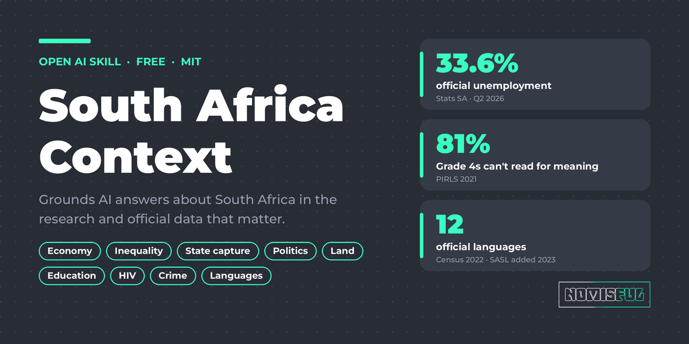
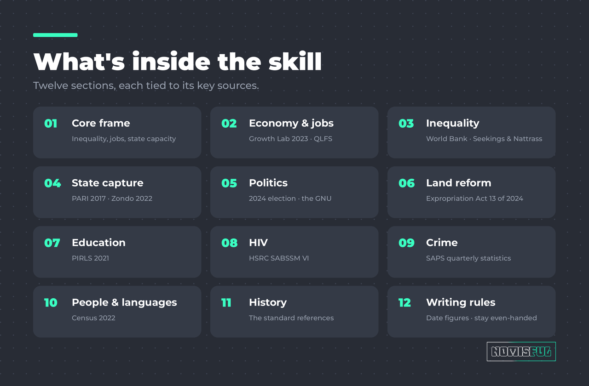
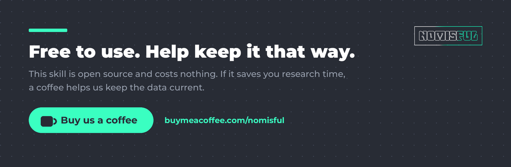

<p align="center">
  
</p>

<p align="center">
  <a href="LICENSE"></a>
  
  <a href="https://buymeacoffee.com/nomisful"></a>
</p>

# South Africa Context

An open skill that helps AI models answer questions about South Africa accurately. It packs the most cited research and the latest official statistics into one briefing, with rules for dating figures, citing sources and staying even-handed.

It is free to use, under the MIT licence.

## Why

General-purpose AI models often get South Africa wrong. Their statistics are out of date, their politics stops at 2024, and they swing between "failed state" and "rainbow nation success story". This skill gives the model a sourced baseline and tells it when to check for something newer.

<p align="center">
  
</p>

## What's inside

```
south-africa-context/
├── SKILL.md              # the briefing the model reads
└── references/
    └── sources.md        # links for every source named in SKILL.md
```

The briefing covers:

| Section | Key sources |
| --- | --- |
| Economy and jobs | Harvard Growth Lab (2023), Stats SA QLFS Q2 2026, Kingdon & Knight (2004) |
| Inequality | World Bank (2022), Seekings & Nattrass (2005), Chatterjee, Czajka & Gethin (2022) |
| Governance and state capture | Public Protector (2016), PARI *Betrayal of the Promise* (2017), Zondo Commission (2022) |
| Politics | 2024 election, the Government of National Unity, 2026 local elections |
| Land reform | Expropriation Act 13 of 2024 |
| Education | PIRLS 2021 |
| Health: HIV | HSRC SABSSM VI (2024) |
| Crime | SAPS quarterly statistics, ISS |
| People and languages | Census 2022 |
| History | Thompson, Freund, Clark & Worger |

## Install

**Claude Code**

```bash
git clone https://github.com/Nomisful/south-africa-context-skill.git
cp -r south-africa-context-skill/south-africa-context ~/.claude/skills/
```

**Claude apps (claude.ai and desktop)**

Download the `south-africa-context` folder as a ZIP and upload it under **Settings → Capabilities → Skills**.

**Other AI tools**

`SKILL.md` is plain Markdown. Paste it into a system prompt, a custom GPT's instructions or a project knowledge file.

## Keeping it current

Unemployment, crime, coalition politics and court cases change fast. The skill tells the model to re-check those against the official source before stating them as current. We plan to refresh the figures after each major release, such as the quarterly labour force survey, SAPS crime statistics and election results.

Spotted an outdated figure or a missing source? [Open an issue](https://github.com/Nomisful/south-africa-context-skill/issues) or send a pull request with a link to the primary source.

## Support the project

<p align="center">
  <a href="https://buymeacoffee.com/nomisful"></a>
</p>

This skill is free and will stay free. If it saves you research time, you can [buy us a coffee](https://buymeacoffee.com/nomisful). It helps us keep the data up to date.

## Disclaimer

This skill summarises published research and official statistics in its own words. It is not legal, financial or medical advice. Check figures against the primary sources in `references/sources.md` before relying on them.

## Licence

[MIT](LICENSE) © 2026 [Nomisful (Pty) Ltd](https://simonbanda.com)
